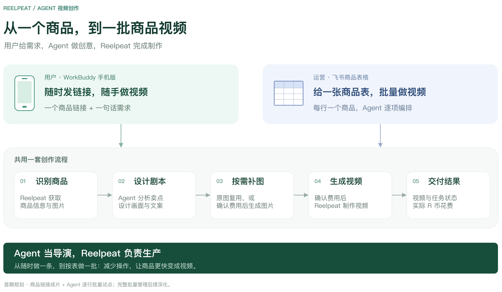
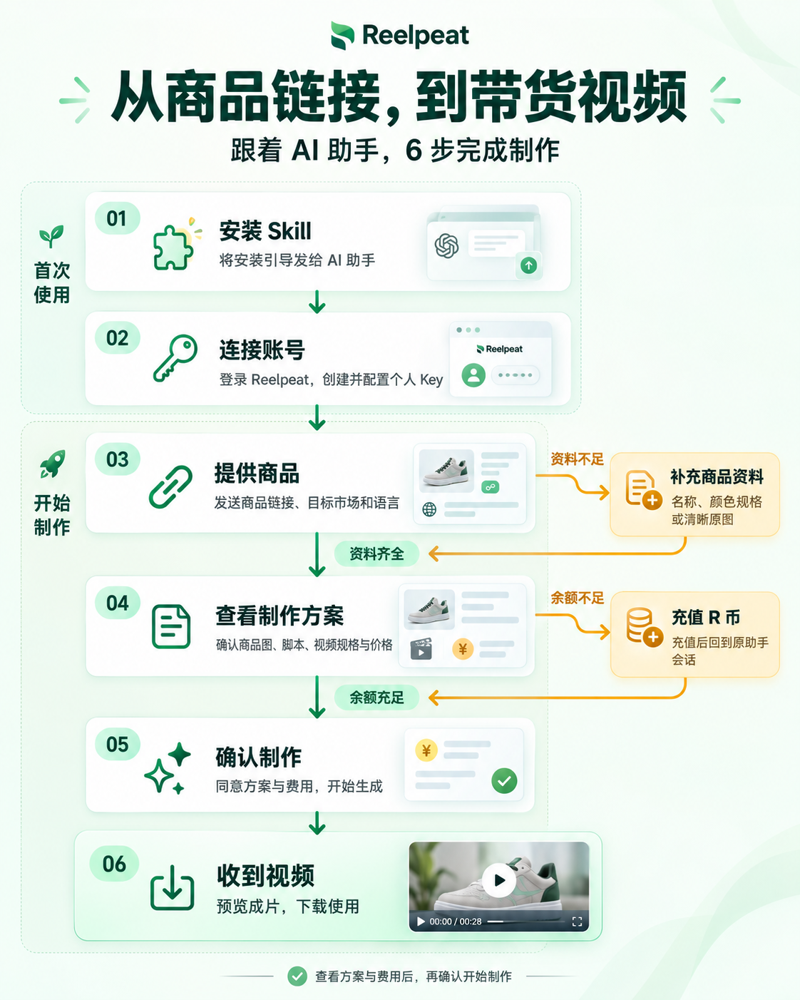

# Reelpeat 电商图片与视频创作 Skill

发商品链接，或商品图片与信息，让 AI 助手设计商品主图、场景图、海报或视频脚本，Reelpeat 完成制作。支持单条创作和表格批次，先看方案与正式报价，确认后再生成。



## 安装与配置

将下面这段话发给你的 AI 助手：

```text
请帮我安装 Reelpeat Skill，并引导我配置个人 Key：
https://github.com/Reelpeat/reelpeat-product-video
```

安装后回复“帮我配置 Key”，助手会引导你[注册／登录 Reelpeat](https://www.reelpeat.com/vorder/login?utm_source=skill&utm_medium=skill&utm_campaign=reelpeat_launch_202610&utm_content=first_setup&skill_id=reelpeat-product-video&skill_version=1.5.1&acq_id=6758f90bad86432697941a01f3af3d3c&redirect=%2Fvorder%2Fapp%3Faccount_action%3Dapi-keys)、创建个人 Key，并提供 **Agent 代配、临时网页、终端命令**三种配置方式。聊天或工具记录可能保留发送的 Key，也可以选择网页或终端自行填写。已有配置直接沿用。

需要助手支持 Skill、联网、执行 Node.js 和查看图片；最低 Node.js 18.3.0，无需 Python 或 MCP。

下载与更新说明：[Reelpeat 官方 GitHub](https://github.com/Reelpeat/reelpeat-product-video)。通过技能市场安装的优先原平台更新；需要时可选择官方最新版，保留已有 Key 配置和任务记录。

## 开始制作

**单独生成商品图：**

> 用这张商品原图生成一张马来西亚家庭厨房场景图，保持同款黑色套装。先给我看方案和正式报价，只生成图片。


**商品链接：**

> 把这个商品做成马来西亚市场的带货视频，用马来语，突出日常使用场景：[商品链接]

**只有图片也可以：**

> 用我发的图片制作带货视频。商品是黑色锅具套装，目标市场马来西亚，突出整套展示和日常备餐场景。

**批量制作：**

> 按这张商品表制作视频，统一面向马来西亚市场。先整理方案和报价，给我一次确认。

可以补充卖点、语言、风格和时长，不确定的部分由助手整理。表格需通过宿主已授权的连接器读取，或提供导出的 CSV/XLSX。

## 使用流程



资料不足时补充商品信息或清晰图片；余额不足时充值后回到原会话。生图先确认生成方案、数量和正式报价；视频先确认参考图、脚本、规格和正式报价。

手机端、表格读取及图片补图以宿主和当前服务实际开放能力为准。

---

[Skill 规则](SKILL.md) · [配置与命令](references/client-usage.md) · [批次制作](references/recovery-and-batch.md) · [维护与打包](docs/maintaining.md)
